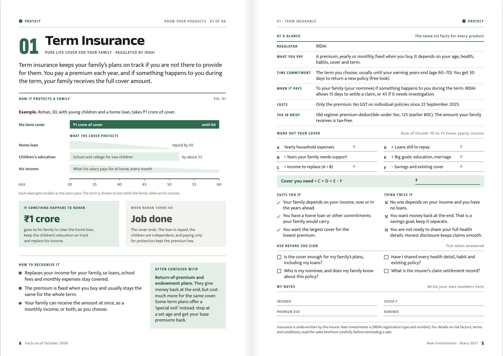

# RI Diary · "Know Your Products"

The product section of the Ram Investments 2027 diary: a 28-page field guide to the eight products the firm offers. Each product gets the same two-page entry, so clients learn the layout once and can compare products side by side. SIF and AIF also get an in-depth spread straight after their entry.



## What is in the section

| Pages | Content |
|---|---|
| 1–3 | Opener and contents · how to read an entry · four jobs your money can do |
| 4–9 | Term Insurance, Health Insurance, Mutual Funds |
| 10–13 | SIF, then SIF in depth |
| 14–17 | NCDs, PMS |
| 18–21 | AIF, then AIF in depth (private markets) |
| 22–23 | GIFT City |
| 24–25 | All eight compared across one spread |
| 26–28 | Words to know · quarterly money check-up · important information |

The products are grouped by the job they do: **Protect** (term, health), **Build** (mutual funds, SIF, NCDs), **Specialise** (PMS, AIF) and **Globalise** (GIFT City). SIF sits next to mutual funds so fund investors read it next and see it as part of the same portfolio.

Two house rules run through every page: **no returns** (no return figures, projections or growth illustrations), and **family-first wording** on the insurance pages (no talk of death; the cover keeps the family's plans on track). Both are set out in [`docs/02-framework.md`](docs/02-framework.md).

## Files

| Path | What it is |
|---|---|
| [`product-section/dist/know-your-products-proof.pdf`](product-section/dist/know-your-products-proof.pdf) | 28-page A5 proof for review |
| [`product-section/dist/previews/`](product-section/dist/previews/) | One image per spread |
| [`docs/01-visual-benchmarks.md`](docs/01-visual-benchmarks.md) | What asset managers, insurers and regulators do well visually, how Indian insurers talk about protection, and what we adopted |
| [`docs/02-framework.md`](docs/02-framework.md) | The framework: section plan, four jobs, anatomy of an entry and of the in-depth spreads, visual and writing rules, the no-returns rule and the insurance tone guide |
| [`docs/03-fact-sheet.md`](docs/03-fact-sheet.md) | Every fact on the pages with its source and what compliance still has to verify, plus the figures researched but held back |
| [`docs/04-production-plan.md`](docs/04-production-plan.md) | How to get it professionally done: roles, timeline, designer and printer briefs, compliance checklist |
| `product-section/src/` | Source: copy (`content/products.mjs`), diagrams (`plates/`), gauges (`gauges/`), front and back matter and the in-depth spreads (`pages/`), styles |
| `product-section/assets/fonts/` | Anek Latin and Mukta (SIL Open Font License) |

## Rebuilding the proof

Requires Node 18+ and Playwright with Chromium.

```sh
node product-section/build.mjs            # HTML only
node product-section/build.mjs --render   # HTML, proof PDF and spread previews
```

The build warns if text runs off a page, past the side margins or into the folio, or if the side-by-side rows stop lining up. Page numbers and cross-references are worked out by the build.

## Before printing

1. Fill every `[placeholder]` (ARN, APRN, IRDAI registration, NCD channel, AIF and GIFT City arrangements, contact details).
2. Have compliance check each **Verify** item in the fact sheet against the primary regulation, and refresh the **Refresh** items (SIF assets, AIF commitments).
3. Have a tax adviser sign off the SIF tax statements.
4. Get written approval for the insurance pages from each insurer partner.
5. Have the designer rebuild the pages for press (CMYK, 3 mm bleed). The HTML proof is the layout master, not the press file.

Facts are as of October 2026.
